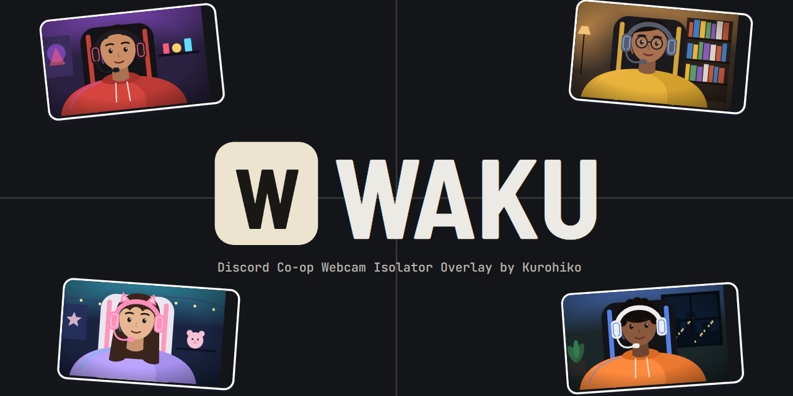

<p align="center">
  
</p>

<h1 align="center">Waku : Discord Co-op Webcam Isolator</h1>

<p align="center">
  <a href="https://kurohiko.id">kurohiko.id</a> ·
  <a href="https://saweria.co/Kurohiko">Donasi via Saweria</a> ·
  <a href="https://kurohikotopup.com">Top up game di KurohikoTopUp</a>
</p>

<p align="center">
  <a href="README.md">English</a> · <b>Bahasa Indonesia</b>
</p>

---

Waku memotong kamera teman co-op dari jendela Discord, menyusunnya jadi satu tampilan, lalu mengirimnya ke OBS sebagai Browser Source. Frame menyala saat orangnya bicara.

## Fitur

- Capture jendela Discord, crop kamera tiap orang jadi frame sendiri, atur posisi dan ukurannya di kanvas 1920x1080.
- Deteksi bicara per frame:
  - **Official**: status bicara langsung dari aplikasi Discord lewat API resmi Discord. Paling akurat.
  - **Manual**: membaca outline hijau Discord di layar.
  - **Nonaktif**: frame tidak pernah menyala.
- Gaya tile: sudut, border, bayangan, label nama, efek bicara (naik, goyang, glow, gelembung), dan beberapa template siap pakai.
- Virtual frame dari gambar (PNG, JPG, GIF bergerak, WebP).
- Preset susunan yang bisa disematkan dan diurutkan, template susunan otomatis, aksi massal, guide, dan magnet.
- Shortcut global dan plugin Stream Deck untuk ganti preset, template, dan deteksi bicara.
- Tetap jalan di tray saat jendelanya ditutup.
- Bahasa Indonesia dan English.

## Kebutuhan

- Windows 10 atau 11 (64-bit)
- Aplikasi Discord desktop
- OBS Studio

## Instal

1. Unduh `Waku-Setup-<versi>.exe` dari halaman [Releases](https://github.com/Kurohiko-id/waku-discord-co-op-webcam-isolator/releases).
2. Jalankan installer. Kalau muncul peringatan Windows SmartScreen, klik **More info** lalu **Run anyway** (installer belum ditandatangani).
3. Pilih bahasa, selesaikan instalasi, lalu buka Waku.

## Persiapan di Discord

- Matikan **Show Non-Video Participants**, supaya grid hanya berisi kamera.
- Klik kanan kamera kamu sendiri, lalu hilangkan centang **Show My Own Camera** kalau tidak ingin ikut tampil.
- Jangan ganti tema atau ukuran jendela Discord saat live, karena crop bisa meleset.
- Perhatikan Streamer Mode, karena bisa mengubah posisi overlay Discord.

## Cara pakai

1. **Hubungkan ke OBS.** Di OBS tambahkan **Browser Source** berukuran 1920x1080. Isi URL dengan alamat preview yang tampil di bar atas Waku (ada tombol salin di sebelahnya), misalnya `http://localhost:6966/preview`.
2. **Capture Discord.** Klik **Capture**, lalu pilih jendela Discord (bertanda *Discord*). Jangan minimize jendela Discord selama live. Jendela boleh tertutup jendela lain.
3. **Tambah frame.** Klik **Tambah frame**, atur kotak crop pas di kamera orangnya, beri nama, lalu **Simpan**. Ikon pensil di tile untuk mengedit lagi.
4. **Atur tampilan.** Geser dan ubah ukuran tile di kanvas. Tahan **Alt** sambil menarik sudut atau sisi untuk memotong tanpa mengubah skala. Pilih template di tab **Tema**.
5. **Pilih deteksi bicara.** Di popup edit frame, pilih **Nonaktif**, **Manual**, atau **Official**.
6. **Simpan preset.** Di tab **Preset**, simpan susunan sekarang. Tombol preset di bawah kanvas menerapkannya dalam satu klik.

Panduan singkat juga ada di tombol **?** di dalam aplikasi.

## Deteksi bicara Official (opsional)

Mode ini memakai API resmi Discord, jadi tidak terganggu warna baju atau latar. Kamu perlu membuat aplikasi Discord sendiri sekali saja:

1. Buka [Discord Developer Portal](https://discord.com/developers/applications), klik **New Application**, lalu beri nama. Nama tidak boleh mengandung kata "discord".
2. Buka menu **OAuth2**, salin **Client ID**.
3. Klik **Reset Secret**, lalu salin **Client Secret**.
4. Di bagian **Redirects**, klik **Add Redirect**, isi `http://localhost`, lalu **Save Changes**.
5. Di Waku buka tab **Atur**, klik **Discord Deteksi Suara**, isi Client ID dan Client Secret, lalu **Simpan & sambungkan**.
6. Klik **Authorize** di popup yang muncul di Discord.

Setelah pill Discord di bar atas tersambung, buka popup edit frame, pilih **Official**, lalu pilih akun orangnya. Client Secret hanya disimpan di PC kamu dalam bentuk terenkripsi.

## Shortcut dan Stream Deck

Di tab **Atur → Shortcut dan Stream Deck** kamu bisa membuat shortcut global untuk ganti preset, ganti template, atau menyalakan dan mematikan deteksi bicara. Shortcut tetap berfungsi walau Waku tersembunyi di tray.

Klik **Pasang plugin Stream Deck** untuk memasang plugin-nya, atau pakai aksi **Hotkey** di Stream Deck dengan kombinasi yang sama.

## Masalah umum

| Masalah | Solusi |
|---|---|
| Tile di OBS hitam atau beku | Jendela Discord kemungkinan di-minimize. Tampilkan lagi jendelanya, atau klik **Capture** ulang. |
| Port sudah dipakai saat Waku dibuka | Pilih **Pakai port kosong lain**, lalu ganti URL Browser Source di OBS. Port bisa diubah lagi di tab **Atur**. |
| Crop meleset | Ukuran jendela Discord atau Streamer Mode berubah. Edit frame dan atur ulang crop-nya. |
| Deteksi Manual menyala terus | Baju, latar, atau green screen berwarna hijau. Geser kotak deteksi atau naikkan ambang di tab **Deteksi**, atau pakai mode **Official**. |
| Discord tidak tersambung | Pastikan aplikasi Discord desktop sedang terbuka, lalu klik pill Discord di bar atas untuk mencoba lagi. |

Untuk melaporkan bug, buka tab **Atur → Laporan bug**, klik **Salin info**, lalu tempel di [Issues](https://github.com/Kurohiko-id/waku-discord-co-op-webcam-isolator/issues). Laporan ini tidak berisi token atau secret Discord.

## Data dan uninstall

Pengaturan, layout, preset, dan gambar unggahan disimpan di `%APPDATA%\Waku`. Uninstall lewat **Settings → Apps** di Windows. Folder data tidak ikut terhapus, jadi hapus manual kalau ingin bersih total.

## Build dari source

Butuh Node.js 20 atau lebih baru.

```
npm install
npm run app      # jalankan aplikasi (mode dev)
npm test         # jalankan tes
npm run dist     # buat installer di dist/
```

---

Font di `public/fonts` (Baloo 2, Barlow, Barlow Semi Condensed) memakai SIL Open Font License 1.1.
