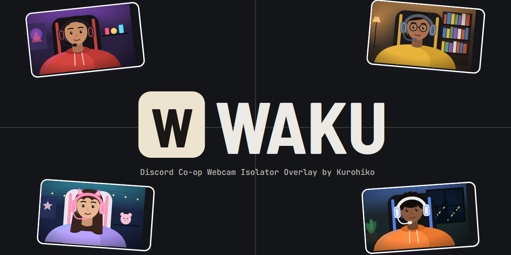

<p align="center">
  
</p>

<h1 align="center">Waku : Discord Co-op Webcam Isolator</h1>

<p align="center">
  <a href="https://kurohiko.id">kurohiko.id</a> ·
  <a href="https://saweria.co/Kurohiko">Donate via Saweria</a> ·
  <a href="https://kurohikotopup.com">Top up game di KurohikoTopUp</a>
</p>

<p align="center">
  <a href="#bahasa-indonesia">Bahasa Indonesia</a> · <a href="#english">English</a>
</p>

---

## Bahasa Indonesia

Waku memotong kamera teman co-op dari jendela Discord, menyusunnya jadi satu tampilan, lalu mengirimnya ke OBS sebagai Browser Source. Frame menyala saat orangnya bicara.

### Fitur

- Capture jendela Discord, crop kamera tiap orang jadi frame sendiri, atur posisi dan ukurannya di kanvas 1920x1080.
- Deteksi bicara per frame:
  - **Official**: status bicara langsung dari aplikasi Discord lewat API resmi Discord. Paling akurat.
  - **Manual**: membaca outline hijau Discord di layar.
  - **Nonaktif**: frame tidak pernah menyala.
- Gaya tile: sudut, border, bayangan, label nama, efek bicara (naik, goyang, glow, gelembung), dan beberapa template siap pakai.
- Virtual frame dari gambar (PNG, JPG, GIF bergerak, WebP).
- Preset susunan yang bisa disematkan dan diurutkan, template susunan otomatis, aksi massal, guide, dan magnet.
- Shortcut global dan plugin Stream Deck untuk ganti preset, template, dan deteksi bicara.
- Tetap jalan di tray saat jendelanya ditutup.
- Bahasa Indonesia dan English.

### Kebutuhan

- Windows 10 atau 11 (64-bit)
- Aplikasi Discord desktop
- OBS Studio

### Instal

1. Unduh `Waku-Setup-<versi>.exe` dari halaman [Releases](https://github.com/Kurohiko-id/waku-discord-co-op-webcam-isolator/releases).
2. Jalankan installer. Kalau muncul peringatan Windows SmartScreen, klik **More info** lalu **Run anyway** (installer belum ditandatangani).
3. Pilih bahasa, selesaikan instalasi, lalu buka Waku.

### Persiapan di Discord

- Matikan **Show Non-Video Participants**, supaya grid hanya berisi kamera.
- Klik kanan kamera kamu sendiri, lalu hilangkan centang **Show My Own Camera** kalau tidak ingin ikut tampil.
- Jangan ganti tema atau ukuran jendela Discord saat live, karena crop bisa meleset.
- Perhatikan Streamer Mode, karena bisa mengubah posisi overlay Discord.

### Cara pakai

1. **Hubungkan ke OBS.** Di OBS tambahkan **Browser Source** berukuran 1920x1080. Isi URL dengan alamat preview yang tampil di bar atas Waku (ada tombol salin di sebelahnya), misalnya `http://localhost:6966/preview`.
2. **Capture Discord.** Klik **Capture**, lalu pilih jendela Discord (bertanda *Discord*). Jangan minimize jendela Discord selama live. Jendela boleh tertutup jendela lain.
3. **Tambah frame.** Klik **Tambah frame**, atur kotak crop pas di kamera orangnya, beri nama, lalu **Simpan**. Ikon pensil di tile untuk mengedit lagi.
4. **Atur tampilan.** Geser dan ubah ukuran tile di kanvas. Tahan **Alt** sambil menarik sudut atau sisi untuk memotong tanpa mengubah skala. Pilih template di tab **Tema**.
5. **Pilih deteksi bicara.** Di popup edit frame, pilih **Nonaktif**, **Manual**, atau **Official**.
6. **Simpan preset.** Di tab **Preset**, simpan susunan sekarang. Tombol preset di bawah kanvas menerapkannya dalam satu klik.

Panduan singkat juga ada di tombol **?** di dalam aplikasi.

### Deteksi bicara Official (opsional)

Mode ini memakai API resmi Discord, jadi tidak terganggu warna baju atau latar. Kamu perlu membuat aplikasi Discord sendiri sekali saja:

1. Buka [Discord Developer Portal](https://discord.com/developers/applications), klik **New Application**, lalu beri nama. Nama tidak boleh mengandung kata "discord".
2. Buka menu **OAuth2**, salin **Client ID**.
3. Klik **Reset Secret**, lalu salin **Client Secret**.
4. Di bagian **Redirects**, klik **Add Redirect**, isi `http://localhost`, lalu **Save Changes**.
5. Di Waku buka tab **Atur**, klik **Discord Deteksi Suara**, isi Client ID dan Client Secret, lalu **Simpan & sambungkan**.
6. Klik **Authorize** di popup yang muncul di Discord.

Setelah pill Discord di bar atas tersambung, buka popup edit frame, pilih **Official**, lalu pilih akun orangnya. Client Secret hanya disimpan di PC kamu dalam bentuk terenkripsi.

### Shortcut dan Stream Deck

Di tab **Atur → Shortcut dan Stream Deck** kamu bisa membuat shortcut global untuk ganti preset, ganti template, atau menyalakan dan mematikan deteksi bicara. Shortcut tetap berfungsi walau Waku tersembunyi di tray.

Klik **Pasang plugin Stream Deck** untuk memasang plugin resminya, atau pakai aksi **Hotkey** di Stream Deck dengan kombinasi yang sama.

### Masalah umum

| Masalah | Solusi |
|---|---|
| Tile di OBS hitam atau beku | Jendela Discord kemungkinan di-minimize. Tampilkan lagi jendelanya, atau klik **Capture** ulang. |
| Port sudah dipakai saat Waku dibuka | Pilih **Pakai port kosong lain**, lalu ganti URL Browser Source di OBS. Port bisa diubah lagi di tab **Atur**. |
| Crop meleset | Ukuran jendela Discord atau Streamer Mode berubah. Edit frame dan atur ulang crop-nya. |
| Deteksi Manual menyala terus | Baju, latar, atau green screen berwarna hijau. Geser kotak deteksi atau naikkan ambang di tab **Deteksi**, atau pakai mode **Official**. |
| Discord tidak tersambung | Pastikan aplikasi Discord desktop sedang terbuka, lalu klik pill Discord di bar atas untuk mencoba lagi. |

Untuk melaporkan bug, buka tab **Atur → Laporan bug**, klik **Salin info**, lalu tempel di [Issues](https://github.com/Kurohiko-id/waku-discord-co-op-webcam-isolator/issues). Laporan ini tidak berisi token atau secret Discord.

### Data dan uninstall

Pengaturan, layout, preset, dan gambar unggahan disimpan di `%APPDATA%\Waku`. Uninstall lewat **Settings → Apps** di Windows. Folder data tidak ikut terhapus, jadi hapus manual kalau ingin bersih total.

### Build dari source

Butuh Node.js 20 atau lebih baru.

```
npm install
npm run app      # jalankan aplikasi (mode dev)
npm test         # jalankan tes
npm run dist     # buat installer di dist/
```

---

## English

Waku crops your co-op friends' cameras out of the Discord window, arranges them into one layout, and sends it to OBS as a Browser Source. A frame lights up when that person speaks.

### Features

- Capture the Discord window, crop each person's camera into its own frame, and position and size it on a 1920x1080 canvas.
- Speaking detection per frame:
  - **Official**: speaking status straight from the Discord app through Discord's official API. Most accurate.
  - **Manual**: reads Discord's green outline on screen.
  - **Off**: the frame never lights up.
- Tile styling: corners, border, shadow, name label, speaking effects (rise, shake, glow, bubbles), plus ready-made templates.
- Virtual frames from images (PNG, JPG, animated GIF, WebP).
- Layout presets you can pin and reorder, automatic arrangements, bulk actions, guides, and snapping.
- Global shortcuts and a Stream Deck plugin to switch presets, templates, and speaking detection.
- Keeps running in the tray when the window is closed.
- English and Indonesian.

### Requirements

- Windows 10 or 11 (64-bit)
- Discord desktop app
- OBS Studio

### Install

1. Download `Waku-Setup-<version>.exe` from [Releases](https://github.com/Kurohiko-id/waku-discord-co-op-webcam-isolator/releases).
2. Run the installer. If Windows SmartScreen shows a warning, click **More info**, then **Run anyway** (the installer isn't signed yet).
3. Choose a language, finish the install, and open Waku.

### Discord setup

- Turn off **Show Non-Video Participants** so the grid only contains cameras.
- Right-click your own camera and uncheck **Show My Own Camera** if you don't want to appear.
- Don't change Discord's theme or window size while live, or crops can drift.
- Watch out for Streamer Mode, as it can move Discord's overlay.

### Usage

1. **Connect OBS.** In OBS, add a 1920x1080 **Browser Source**. Use the preview address shown in Waku's top bar (there's a copy button next to it), for example `http://localhost:6966/preview`.
2. **Capture Discord.** Click **Capture** and choose the Discord window (marked *Discord*). Don't minimize Discord while live. Other windows may cover it.
3. **Add frames.** Click **Add frame**, fit the crop box to the person's camera, give it a name, then **Save**. Use the pencil icon on the tile to edit it again.
4. **Arrange.** Drag and resize tiles on the canvas. Hold **Alt** while dragging a corner or edge to crop without changing the scale. Pick a template in the **Theme** tab.
5. **Choose speaking detection.** In the edit frame popup, choose **Off**, **Manual**, or **Official**.
6. **Save presets.** In the **Preset** tab, save the current arrangement. The preset buttons below the canvas apply it in one click.

A short guide is also available from the **?** button inside the app.

### Official speaking detection (optional)

This mode uses Discord's official API, so clothing and background colors don't interfere. You need to create your own Discord application once:

1. Open the [Discord Developer Portal](https://discord.com/developers/applications), click **New Application**, and name it. The name can't contain the word "discord".
2. Open **OAuth2** and copy the **Client ID**.
3. Click **Reset Secret** and copy the **Client Secret**.
4. Under **Redirects**, click **Add Redirect**, enter `http://localhost`, then **Save Changes**.
5. In Waku, open the **Settings** tab, click **Discord Voice Detection**, enter the Client ID and Client Secret, then **Save & connect**.
6. Click **Authorize** in the popup that appears in Discord.

Once the Discord pill in the top bar is connected, open the edit frame popup, choose **Official**, and pick the person's account. The Client Secret is stored only on your PC, encrypted.

### Shortcuts and Stream Deck

In **Settings → Shortcuts and Stream Deck** you can create global shortcuts to switch presets, switch templates, or turn speaking detection on and off. Shortcuts work even while Waku is hidden in the tray.

Click **Install Stream Deck plugin** to install the plugin, or use a Stream Deck **Hotkey** action with the same key combination.

### Troubleshooting

| Problem | Fix |
|---|---|
| Tiles in OBS are black or frozen | Discord is probably minimized. Restore the window, or click **Capture** again. |
| Port already in use when opening Waku | Choose **Use another free port**, then update the Browser Source URL in OBS. You can change the port again in **Settings**. |
| Crop is off | Discord's window size or Streamer Mode changed. Edit the frame and adjust the crop. |
| Manual detection stays lit | Green clothing, background, or green screen. Move the detection box, raise the threshold in the **Detection** tab, or use **Official** mode. |
| Discord won't connect | Make sure the Discord desktop app is open, then click the Discord pill in the top bar to retry. |

To report a bug, open **Settings → Bug report**, click **Copy info**, and paste it into [Issues](https://github.com/Kurohiko-id/waku-discord-co-op-webcam-isolator/issues). The report contains no Discord token or secret.

### Data and uninstall

Settings, layouts, presets, and uploaded images are stored in `%APPDATA%\Waku`. Uninstall from Windows **Settings → Apps**. The data folder is kept, so delete it manually for a clean removal.

### Build from source

Requires Node.js 20 or newer.

```
npm install
npm run app      # run the app (dev mode)
npm test         # run tests
npm run dist     # build the installer in dist/
```

---

Fonts in `public/fonts` (Baloo 2, Barlow, Barlow Semi Condensed) are licensed under the SIL Open Font License 1.1.
